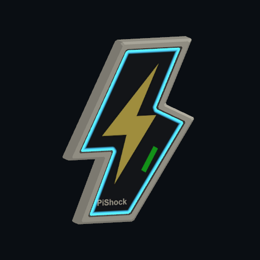
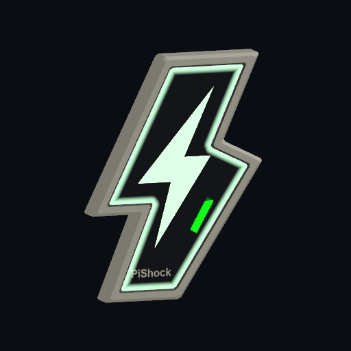
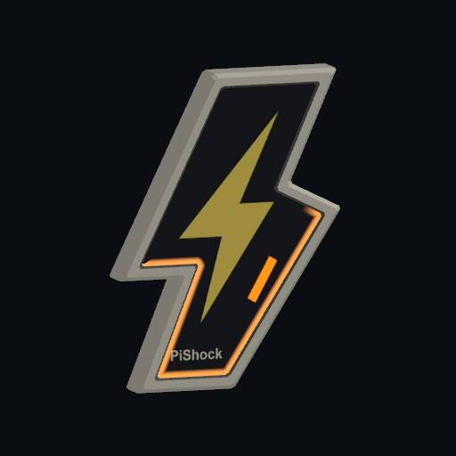
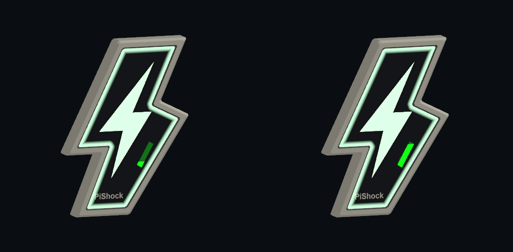
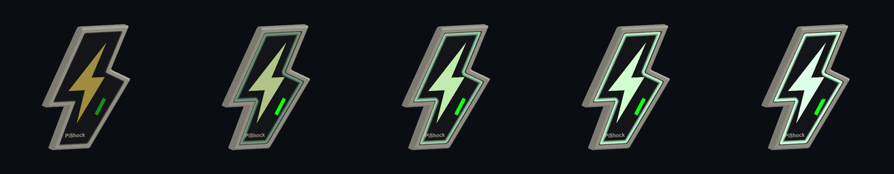

# Furroxide ShockOSC Avatars

Modular lightning badges for VRChat avatars, with independent touch channels, per-group feedback, and an optional PC mesh merge. Each badge uses 244 triangles and the same two 512 × 512 texture maps.

This is the Furroxide-maintained fork of [Kyobinoyo's OpenShock prefabs](https://github.com/Kyobinoyo/OpenshockPrefabs). The Shocker controller, parameter asset, animation clips and VRCFury configuration were adapted for the replacement badge. The original model, textures and Poiyomi material are excluded from the maintained package. The [original prefab documentation](docs/upstream-prefabs.md) and upstream history are preserved.

**Development test release:** `0.2.0` adds per-group active and cooldown visuals, local contact-attempt feedback, a full-bolt active cue, secondary intensity feedback and a cooldown perimeter. The earlier `0.1.0` remains available. Upstream redistribution terms and the live VRChat/bridge test remain unverified. Development follows the owner's open-source assumption; this is not a confirmed licence grant. See [licensing status](Unity/Packages/com.furroxide.shockosc-avatar/LICENSE.md) and [release checks](docs/development.md#release-checks).

## Feedback gallery

Version 0.2.0 adds these distinct cues to the earlier badge. The images show the installed PC shader in Unity. Cyan means a local touch attempt; the illuminated bolt and amber perimeter reflect ShockOSC's group status, not a physical-device acknowledgement.

| Local contact attempt | Group active | Group cooldown |
| --- | --- | --- |
|  |  |  |

**Reported intensity: 20% left, 90% right**

**Smooth activation: five visual-strength stages**

The final strip samples five visual strengths from 0 to 1; the Animator eases between states in about 0.1–0.12 seconds and holds the Active appearance. The small intensity mark shows the bridge-reported command level while Active, with synchronization off by default.

## Install with Creator Companion

Use a test avatar project first. For an existing custom installation, follow the [migration guide](docs/upgrading.md) before adding the VCC package.

1. Open the [ShockOSC repository site](https://furroxide.github.io/OpenshockPrefabs/) and click **Add repository to Creator Companion**. Add the [VRCFury repository](https://vcc.vrcfury.com/) too if it is not already configured.
2. Open **Manage Project** for your humanoid avatar project and install **Furroxide ShockOSC Avatars 0.2.0**.
3. In Unity, open **Packages → Furroxide ShockOSC Avatars → OSC**. Drag the single-badge or four-badge prefab under your avatar root.
4. Fit each badge and set its **Group Name** field to the matching ShockOSC group, without the `ShockOsc/` prefix. Follow the [fitting guide](Unity/Packages/com.furroxide.shockosc-avatar/README.md) for feedback channels and the four-badge prefab.

The development releases have no prerelease suffix and appear without enabling **Show Pre-Release Packages**. The [listing JSON](https://furroxide.github.io/OpenshockPrefabs/index.json) includes published releases only. For local development without publication, use a VCC user package; see [development](docs/development.md).

## Compatibility

| Area | Requirement or limit |
| --- | --- |
| Unity | 2022.3.22f1 |
| VRChat Avatars SDK | `>=3.10.6 <3.11.0` |
| VRCFury | `>=1.1457.0 <2.0.0` |
| Optional optimizer | d4rkAvatarOptimizer 4.6.0 is the current validation target. Install it separately before importing the preset sample. |
| Platform | PC avatar assets. Android/Quest support is not claimed. |
| Desktop application | ShockOSC in OpenShock Desktop must be configured and running separately. No desktop app, credentials or device configuration are included. |

VCC resolves the required SDK and VRCFury packages from repositories you have added. It does not install d4rkAvatarOptimizer automatically.

## Other installation and upgrades

- The versioned `PiShockBolt-Modular-OSC-0.2.0.unitypackage` is the fallback for manual installation. Install the SDK and VRCFury first. The optimizer preset is a separate optional archive.
- Choose one installation format per project. When upgrading the custom Unity package, run the backed-up GUID migration helper before installing through VCC; it preserves avatar-specific placement presets. Read [upgrading](docs/upgrading.md) before switching formats.
- [Avatar fitting, channels and optimizer setup](Unity/Packages/com.furroxide.shockosc-avatar/README.md)
- [Official ShockOSC avatar setup](https://wiki.openshock.org/guides/shockosc/avatar-setup-vrc)
- [Builds, tests and release process](docs/development.md)

## Source and terms

The package's [third-party notices](Unity/Packages/com.furroxide.shockosc-avatar/THIRD_PARTY_NOTICES.md) identify the reused integration and the separate dependencies. The desktop ShockOSC application's licence is not used as a substitute for the prefab repository's missing terms.
